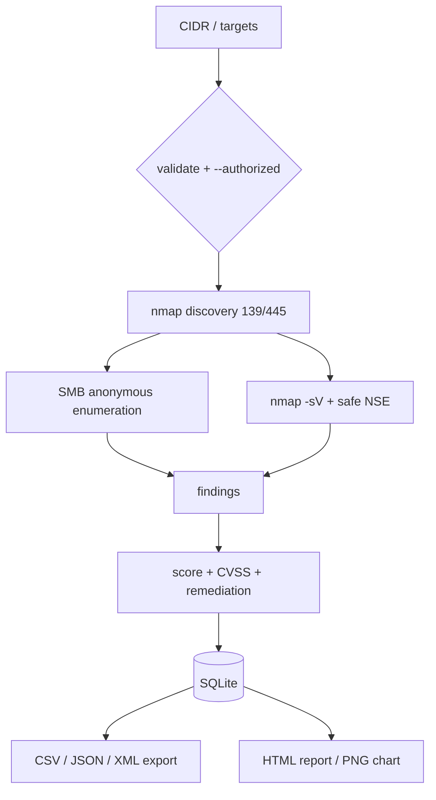

# VulnR_ScannR

**VulnR_ScannR** is a Python command-line tool for running *authorized* SMB and network exposure assessments.
It drives standard tools (nmap, smbclient, NetExec, and optionally impacket and Metasploit auxiliary scanners),
scores each host's exposure from 0 to 100, suggests fixes, and writes CSV, JSON, XML and HTML reports.
Results are stored in SQLite (`smb_enum.db`, which uses the same schema as earlier versions).

> ⚠️ **Authorized use only.** Only scan systems you own or have written permission to test.
> Network commands refuse to run unless you pass `--authorized`. Unauthorized scanning may be illegal.

Version 2.0 rebuilds the project as an installable package. The old scripts are summarized in
[docs/MIGRATION.md](docs/MIGRATION.md).

## Features

| Area | What it does |
|---|---|
| Discovery | Finds hosts with SMB (139/445) open in a CIDR (`nmap -oG`) |
| SMB enumeration | Anonymous/null-session checks with `smbclient`, NetExec (`nxc`; CrackMapExec is used if it is the only one installed), `impacket-lookupsid`, `enum4linux(-ng)` and `rpcclient`. Flags *SMB signing not required* and *SMBv1* |
| Intensity enumeration | impacket levels 1–3: shares → logged-on users → sessions and share readability (`[smb]` extra) |
| Nmap | Parallel `-sV` scans of common service ports, with optional NSE categories limited to `default,safe,discovery,version,vuln`. XML output is parsed into findings |
| Metasploit | Runs one **allowlisted auxiliary scanner** module, only when you ask for it (`list-modules`) |
| Scoring | Starts at 100 and subtracts penalties for findings, open and high-risk ports, credentials, missing patches and CVSS. Risk levels are Low, Medium, High and Critical. Optional CVE→CVSS lookup via the NVD 2.0 API (`--nvd`) |
| Remediation | Fix advice for each finding, with reference links |
| Reporting | CSV/JSON/XML export (stdlib), a static HTML report, and an optional PNG chart (`[plot]` extra) |
| Scheduling | Runs the full workflow daily or weekly in the foreground |
| UI | Subcommand CLI, plus an interactive `menu` that keeps the old menu-driven workflow |

## Requirements

* Python **3.11+** (tested on 3.11, 3.12, 3.13 and 3.14)
* Linux or macOS. Install the external tools you want with your OS package manager. The tool never installs anything by itself:
  * [nmap](https://nmap.org/), needed for discovery, `nmap` and `scan`
  * Samba client tools (`smbclient`, `rpcclient`), [NetExec](https://github.com/Pennyw0rth/NetExec),
    [enum4linux-ng](https://github.com/cddmp/enum4linux-ng): optional; any that are missing are skipped
  * Metasploit Framework (`msfconsole`): optional
* Optional Python extras: `smb` ([impacket](https://github.com/fortra/impacket)) and `plot` (matplotlib)

Run `vulnr-scannr check-deps` to see what is available.

## Installation

```bash
git clone https://github.com/elithaxxor/VulnR_ScannR.git
cd VulnR_ScannR
python3 -m venv .venv && . .venv/bin/activate
pip install ".[all]"        # or: pip install .   (core only, no third-party deps)
```

`requirements.txt` lists the optional extras for people who prefer `pip install -r requirements.txt`.

## Usage

```bash
vulnr-scannr --help
vulnr-scannr check-deps

# Full workflow: discover -> enumerate -> nmap -> score (-> export + HTML report)
vulnr-scannr --authorized scan 192.168.56.0/24 --report

# Individual steps
vulnr-scannr --authorized discover 192.168.56.0/24 --enumerate -o findings.json
vulnr-scannr --authorized nmap 192.168.56.10,192.168.56.11 --scripts safe,vuln -o nmap.json
vulnr-scannr --authorized smb-intensity 192.168.56.10 --level 3 --username alice --domain LAB
vulnr-scannr list-modules
vulnr-scannr --authorized metasploit 192.168.56.10 --module smb_version

# Offline: score findings, export, report
vulnr-scannr score findings.json            # add --no-cvss for the old modular algorithm, --nvd for CVE lookups
vulnr-scannr export --format csv --format json
vulnr-scannr report --plot                  # reports/report.html (+ PNG)

# Scheduled (foreground; stop with Ctrl+C)
vulnr-scannr --authorized schedule 192.168.56.0/24 --frequency weekly --time 03:00

# Interactive menu (old UI)
vulnr-scannr menu
```

### Interactive menu

`vulnr-scannr menu` (or `python main.py menu`) offers the same workflows with prompts:

* a header showing the database and whether `--authorized` was given; network options (1–4) ask for
  confirmation unless it was, and declining scans nothing
* options whose tool or Python extra is missing are flagged, e.g. `(needs nmap - not installed)`, and are not run
* every input is validated on entry (CIDR size, IPs, intensity, module allowlist, file exists), with up to 3 tries
* Ctrl+C or Ctrl+D at a prompt returns to the menu; at the main prompt it exits cleanly
* a plain-language result after each action (`Done.`, missing tool, input/authorization problem)

Colour is used only on a terminal. Set `NO_COLOR=1` to turn it off, or `FORCE_COLOR=1` to force it. Output sent to a
pipe or file never contains escape codes. Long runs print phase progress such as `[2/5] Enumerating 3 SMB host(s)`,
`[smb 1/3] 192.168.56.10` and `[nmap 2/3] finished 192.168.56.11`. These are counts, not time estimates.

The old entry points still work and call the same CLI: `python main.py ...`,
`python Vuln_Scan_II/modular_version/main.py ...` and `python Vuln_Scan_II/single_liner/main.py ...`.
You can also use `python -m vulnr_scannr`.

Global options: `--db PATH`, `-v/--verbose`, `-q/--quiet`, and `--max-addresses N` (largest CIDR allowed; default 4096).
Exit codes: `0` ok, `1` runtime error, `2` usage/validation/authorization error, `3` required tool missing.

**Credentials:** for `smb-intensity`, the password is prompted for without echo, or read from
`VULNR_SMB_PASSWORD`. Passwords are never put on a command line and are redacted from logs.

**NVD:** `--nvd` sends CVE IDs to `services.nvd.nist.gov`. Set `NVD_API_KEY` for higher rate limits
([NVD API docs](https://nvd.nist.gov/developers/vulnerabilities)).

## Data flow



## Scoring

The score starts at 100. Each finding costs 15 points, each open port 5, each plaintext or default credential 10,
each missing patch 5, each high-risk port (21, 22, 23, 25, 53, 139, 445, 1433, 3306, 3389, 5900) another 3,
and each critical (CVSS ≥ 9) finding another 20. The summed CVSS of all findings is also subtracted
(unknown findings count as 5.0). The result is floored at 0. Risk levels: ≥80 Low, ≥50 Medium, ≥20 High, otherwise Critical.

Example input for `score`:

```json
{"192.168.56.10": {"vulnerabilities": ["MS17-010"], "open_ports": [139, 445], "plaintext_creds": 0, "missing_patches": 1}}
```

## Lab validation

The tool integrations (NetExec banner parsing, enum4linux-ng/Samba flags, impacket RPC, Metasploit modules) are covered
by offline contract tests. They still need checking against real tools in an isolated lab. See
[docs/LAB_TESTING.md](docs/LAB_TESTING.md) and `scripts/lab_validate.py` (`flags` and `replay` run offline; `capture`
works only against a single private lab IP and requires `--authorized`).

## Development

```bash
pip install -e ".[dev,all]"
ruff check . && ruff format --check .
pytest --cov=vulnr_scannr
bandit -q -r src -ll
pip-audit
```

Tests replace every external tool with mocks or offline fixtures. A safety fixture makes any test that tries to launch a
real scanner fail. To exercise real tools, use an isolated lab network (for example a host-only VM network)
that you control. Never test against the public internet.

## License

Released under the [MIT License](LICENSE). Copyright (c) 2026 elithaxxor.

Why MIT: the earliest README (commits `c485671` and `162cff2`, April 2025) said the project was
"available under the MIT License", but no LICENSE file was ever added. The later "@copyleft ... feel free to
incorporate it into your work" note is also permissive in spirit. Every commit in the history is by the
repository owner, and no third-party license notices were found in the code. This was a check of the
repository history, not a full legal audit.

## Disclaimer

This tool is meant for security professionals doing authorized assessments. Unauthorized network scanning may
break local, state and federal laws. The author is not responsible for misuse. Do not be unethical, do not harm others,
do the right thing.
